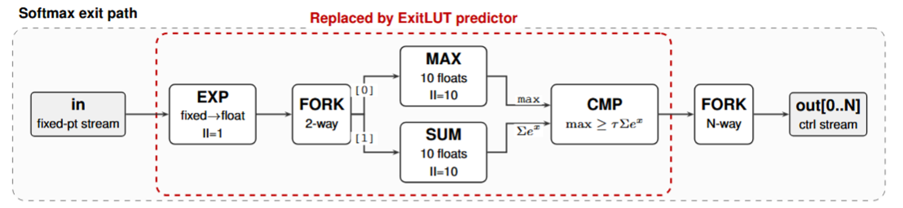

# ExitLUT: Boolean Early Exits for Efficient FPGA-Based Neural Network Inference

This repository contains code for the paper "ExitLUT: Boolean Early Exits for Efficient FPGA-Based Neural Network Inference" by Oliver Cassidy, Marta Andronic and George Constantinides, published in the 2026 International Conference on Field-Programmable Technology (ICFPT).



*Figure: the ATHEENA softmax exit path. The region in the red dashed box is the arithmetic confidence pipeline that ExitLUT replaces with a learned Boolean predictor.*

ExitLUT is a toolflow for implementing early exit decisions as learned Boolean functions, enabling efficient training and deployment of early exit networks on FPGAs. It builds on the [ATHEENA](https://github.com/biggsbenjamin/ATHEENA) and [NeuraLUT-Assemble](https://github.com/MartaAndronic/NeuraLUT) toolflows, which automate the design of hardware early exit networks and the training of LUT-based neural networks, respectively.

## Citation

If ExitLUT contributes to your research, please cite:

```bibtex
@inproceedings{cassidy2026exitlut,
    author    = {Cassidy, Oliver and Andronic, Marta and Constantinides, George A.},
    title     = {{ExitLUT: Boolean Early Exits for Efficient FPGA-Based Neural Network Inference}},
    booktitle = {2026 International Conference on Field-Programmable Technology (ICFPT)},
    publisher = {IEEE},
    year      = {2026}
}
```

ExitLUT builds on NeuraLUT-Assemble and/or ATHEENA; please also cite as relevant:

```bibtex
@inproceedings{andronic2025neuralut-assemble,
    author    = "Andronic, Marta and Constantinides, George A.",
    title     = "{NeuraLUT-Assemble: Hardware-Aware Assembling of Sub-Neural Networks for Efficient LUT Inference}",
    booktitle = "{2025 IEEE 33rd Annual International Symposium on Field-Programmable Custom Computing Machines (FCCM)}",
    pages     = "208-216",
    publisher = "IEEE",
    year      = 2025,
    note      = "doi: 10.1109/FCCM62733.2025.00077"
}
```

```bibtex
@inproceedings{bbiggs_ATHEENA_2023,
    title = {{ATHEENA: A Toolflow for Hardware Early-Exit Network Automation}},
    booktitle = {2023 IEEE 31st Annual International Symposium on Field-Programmable Custom Computing Machines (FCCM)},
    author = {Benjamin Biggs and Christos-Savvas Bouganis and George A. Constantinides},
    year = {2023},
}
```

## License

ExitLUT is released under the [Apache License 2.0](./LICENSE), with one exception: [`ATHEENA-ExitLUT/optimiser/`](./ATHEENA-ExitLUT/optimiser) is a modified copy of the ATHEENA / fpgaConvNet optimiser and is licensed under the [GNU GPL v3](./ATHEENA-ExitLUT/optimiser/LICENSE). See [NOTICE](./NOTICE) for attribution of the third-party work this builds on (LogicNets, NeuraLUT-Assemble, ATHEENA and fpgaConvNet).
